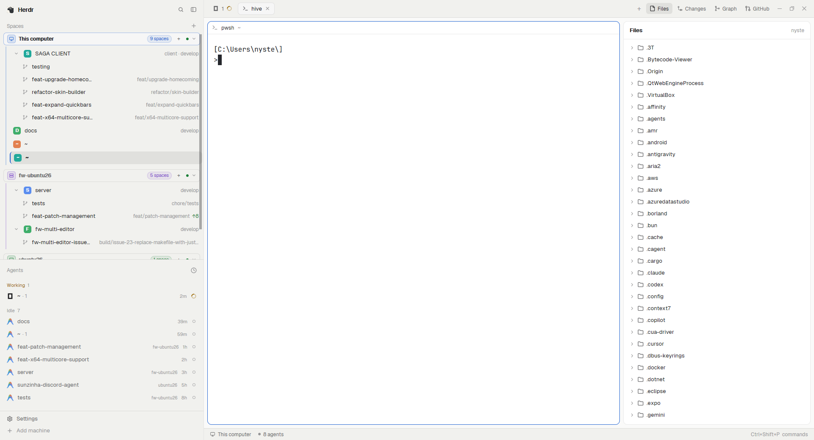

# Hive

**Hive is a [Herdr](https://herdr.dev) layout for people who work in several repositories — and several git worktrees of each — at the same time.**



One window, everything in sight: a sidebar that groups spaces by machine, nests
each repository's worktrees under it like folders you can fold away, the agents
list underneath, tabs as pills with one-click Files / Changes / Graph / GitHub
panels and an optional Insights button, terminal panes drawn as rounded cards with
a header, and a status bar.

Hive ships no program of its own: it is a layout file plus six mods. Everything
runs inside Herdr, using Herdr's own commands and your existing `git` / `gh`. Two
buttons are optional and need mods you install yourself: the GitHub panel's
**Agent** button and the tab bar's **Insights** button.

## Contents

- [Highlights](#highlights)
- [Requirements](#requirements)
- [Installation](#installation)
- [Using Hive](#using-hive)
- [Keyboard shortcuts](#keyboard-shortcuts)
- [Configuration](#configuration)
- [Repository layout](#repository-layout)
- [How it works](#how-it-works)
- [Troubleshooting](#troubleshooting)
- [Notes and limitations](#notes-and-limitations)
- [About the preview](#about-the-preview)
- [Contributing](#contributing)
- [Credits](#credits)
- [License](#license)

## Highlights

- **Worktrees as folders.** Spaces that are worktrees of a repo you already have
  as a space are nested under it, indented with a branch icon. The repo's row has
  a chevron that collapses or expands all of its worktrees at once; folded, a
  small pill shows how many are hidden. The fold survives restarts and is
  remembered per repo, not per space.
- **Spaces grouped by machine.** One group per machine from `hc machine ls`, the
  local computer first. Each header has an icon, the machine name, a count pill, a
  `+` to create a space there, a connection dot, and a chevron that folds the whole
  group. The `+` opens a **New space** dialog where you pick the machine and the
  folder the first terminal starts in.
- **The whole repo, at a glance.** Each space shows its repo and branch only when
  they are not obvious from the name, plus `↑ahead` / `↓behind` when the branch
  has diverged.
- **Stable colors.** Avatars get one of six colors, kept in shared state so every
  mod draws the same color for the same space.
- **Tabs you can read.** Pills with the program icon and tab name, a native
  spinner while the agent works, a colored dot when it is blocked or done, and a
  `×` on the active pill.
- **Panels on demand.** Files, Changes, Graph and GitHub open on the right; each
  space remembers which panel it had open.
- **Optional Insights.** When the `insights` mod is installed, a button beside
  GitHub opens its token-usage dashboard in a tab; without it the button is hidden.
- **A real git panel.** Commit lanes with refs, fetch / push / pull, and the usual
  actions (checkout, branch, tag, stash, cherry-pick, revert, reset) behind
  confirmation dialogs.
- **A GitHub panel.** PRs and issues for the current repo with kind tabs, search,
  sort, label filters and CI badges, plus an **Agent** button that hands an issue
  to the optional `issue-agent` mod.
- **A context menu that fits.** `menu-custom` replaces Herdr's terminal and space
  menus with split / zoom / close, rename, Copy path, worktree actions and theme
  picks.
- **Light and dark.** The layout sets no colors of its own; it follows your Herdr
  theme and settings.

## Requirements

| Requirement | Why |
|---|---|
| [Herdr](https://herdr.dev) **0.1.11** (tested) | Hive uses Herdr layouts and mods. The sidebar and tab bar are clones of Herdr 0.1.10's `spaces` and `tabs`, and the menu of 0.1.11's `menu`. |
| `herdr-core` (`hc`) | Herdr's backend, installed by Herdr's own installer. `spaces-highlight` asks it for the machine list (`hc machine ls --json`). |
| **git** | `spaces-highlight` runs `git status` / `git rev-parse` in each space; `git-graph` runs `git log`, `git fetch`, etc. Must be on the `PATH` of the shell Herdr starts, **on every machine** you show. |
| **gh**, authenticated *(optional)* | Only the GitHub panel and its CI badge. Without it the panel is empty and says so. |
| `issue-agent` mod *(optional)* | Only the **Agent** button in the GitHub panel. It is not part of Herdr nor of this repo; without it the button does nothing. |
| `insights` mod *(optional)* | Only the **Insights** button in the tab bar. It is not part of Herdr nor of this repo; without it the button is hidden. |
| Windows, macOS or Linux | Built and tested on Windows. The layout uses Herdr's `window_drag`, `titlebar: none` and `traffic_lights`, which Herdr handles on every platform. |

Hive does not need Node, a bundler or a build step: mods are plain JavaScript that
Herdr loads directly.

## Installation

Hive is just files. Installing means copying the layout and the six mod folders
into your Herdr home:

- Windows: `%USERPROFILE%\.config\herdr-app`
- macOS / Linux: `~/.config/herdr-app`

(If you run Herdr with `HERDR_APP_HOME`, use that folder instead.)

### 1. Copy the files

Clone the repo somewhere and copy its contents into the Herdr home. The repo
mirrors the app home, so a merge works:

```powershell
# Windows (PowerShell)
$src = "$HOME\src\herdr-layout-hive"          # where you cloned this repo
$dst = "$env:USERPROFILE\.config\herdr-app"

New-Item -ItemType Directory -Force "$dst\layouts", "$dst\mods" | Out-Null
Copy-Item "$src\layouts\hive.json" "$dst\layouts\hive.json" -Force
Copy-Item "$src\mods\*" "$dst\mods\" -Recurse -Force
```

```bash
# macOS / Linux
src="$HOME/src/herdr-layout-hive"
dst="$HOME/.config/herdr-app"

mkdir -p "$dst/layouts" "$dst/mods"
cp "$src/layouts/hive.json" "$dst/layouts/"
cp -r "$src"/mods/* "$dst/mods/"
```

### 2. Reload Herdr

Herdr picks up layouts and mods live; the layout appears in the picker
immediately. Switch to it with the command, the Settings screen, or the layout
key:

```sh
herdr-app do layout.switch --name hive
```

- **Settings → Look → Hive**, or
- `ctrl-shift-l` (Herdr's layout cycle) until Hive shows.

### 3. Check the mods

Ask Herdr to load each mod once and report errors:

```sh
for m in spaces-highlight tabs-graph new-space git-graph github menu-custom; do
  herdr-app check ~/.config/herdr-app/mods/$m
done
```

Each should print `check passed`. In the app, `herdr-app status` lists any errors
from layouts and mods, and a broken file leaves a `<name>.error` next to it.

### If a mod name is already taken

Hive's six folders are `spaces-highlight`, `tabs-graph`, `new-space`, `git-graph`,
`github` and `menu-custom`. Herdr ships `spaces`, `tabs` and `menu`, so the clone
names are normally free — but you may already have your own `github` or
`git-graph`. **Do not overwrite them.** Instead rename the incoming folder and
update the references:

- `layouts/hive.json`: the `content.mod` values and the root `terminal_menu`.
- `mods/spaces-highlight/main.js`: opens the `menu-custom` overlay for a space's
  right-click menu, and the `new-space` dialog for a new space.
- `mods/git-graph/*.js`: opens `git-graph` itself for its menu and dialogs.
- Any `mods/<name>/...` asset path inside the JavaScript (icons, SVGs).

A folder can be renamed only if every reference above is renamed with it.

### Updating

Copy the files again. There is no package manager and no build step. If you edited
the mods locally, merge rather than overwrite.

### Uninstalling

1. Switch to another layout (`ctrl-shift-l` or
   `herdr-app do layout.switch --name main`).
2. Delete `layouts/hive.json` and, if present, `layouts/.state/hive.json` (the
   per-layout click state).
3. Delete the six mod folders under `mods/`.
4. Restart Herdr.

Your spaces, tabs and terminals are untouched — they live in `herdr-core`, not in
the layout.

## Using Hive

### Spaces sidebar

The sidebar is 268 px wide by default. Drag its edge to resize it (44–480 px);
below 160 px the spaces and agents panels switch to a compact rail without names.

**Machine groups.** Spaces are grouped by the machine they live on, local first,
then machines by name. A machine header shows an icon, its name, how many spaces
are listed, a `+` to create a space on that machine, a connected dot and a fold
chevron. Clicking the header folds the group; the state is kept in
`localStorage["machines.folded"]`. The count pill counts the rows the group lists,
so a folded repo's worktrees are not counted separately.

**New space.** The `+` in a machine header, the `+` beside "Spaces", and the
"New space there" row open a dialog: pick the machine (this computer or a
connected remote), type or browse a folder, then **Create space**. The first
terminal starts there; an empty path means the machine's home folder.

**Spaces.** Click a row to switch to that space. Drag it up or down to reorder it
inside its machine — the row dims and a 2 px accent line shows where it will land.
Right-click for the space menu. The active row is `selected` with a 2 px left
border in the machine's color.

**Worktrees.** If a repo's main checkout is a space and another space is a linked
worktree of the same repo (same machine), the worktree is nested under the main
checkout with a branch icon. The repo's row gets a chevron: click it to hide or
show every worktree under it. Folded, the chevron turns right and a pill shows how
many rows are hidden. The fold is stored in `localStorage["worktrees.folded"]`,
keyed by `[machine, .git path]`, so it survives restarts, renames and moves. The
chevron stops the mouse down, so pressing it never starts a drag.

Worktrees stay top-level when the main checkout is not a space, when git cannot
answer for the folder (not a repo, machine offline), or in the 44 px rail (there
is no chevron there, so nothing becomes unreachable).

**Space details.** Next to the name, in dim 11.5 px text, Hive shows only what is
unusual: the repo (if the space is named something else), the branch (if it is not
`main` / `master` / the space's own name), and `↑n` / `↓n` when the branch is
ahead or behind its upstream.

**Avatars.** A space's avatar is a colored square with the first letter of its
name, or a branch icon for a worktree. The color comes from a six-color palette and
is stored in `shared("space.colors")`, so the spaces panel and any other mod agree.

### Tab bar

The 42 px tab bar has:

- **Pills** for the active space's tabs: program icon, tab name, and a close `×` on
  the active pill. A working agent shows a native spinner; blocked and done agents
  show a dot in their theme color.
- Click to select, double-click to rename, drag to reorder, wheel to scroll.
- **`+`** opens Herdr's `new-menu`: a terminal or any installed agent.
- **Files**, **Changes**, **Graph**, **GitHub** toggle the right panel.
- **Insights** (when the `insights` mod is installed) opens its dashboard in a tab,
  beside GitHub. The button is hidden when that mod is missing.
- On Windows, **minimize / maximize / close** are drawn by the mod; on macOS the
  system traffic lights sit over the layout and the bar reserves room for them.

### Panes

A tab's terminals are drawn as cards: 10 px radius, 1 px border (accent while
focused), 8 px gap, and a 30 px header from Herdr's `pane` mod with the folder,
branch, agent state, and split / zoom / close buttons. `lone: true`, so even a tab
with one pane is framed.

Panes can be dragged by the grip that appears at their top edge to swap places or
split beside another pane, as in any Herdr layout.

### Right panel

A 368 px column (280–900, hidden until opened) with a stack of four panels:

| Panel | Comes from | What it shows |
|---|---|---|
| **Files** | Herdr's `files` mod | The focused space's folder tree. |
| **Changes** | Herdr's `changes` mod | Uncommitted changes in the space. |
| **Graph** | `git-graph` | Commit lanes, refs, fetch/push/pull, and git actions. |
| **GitHub** | `github` | PRs and issues for the repo. |

Each space remembers its own panel choice in `localStorage["panels"]`; switching
spaces restores it. Only one panel shows at a time.

### Graph panel

`git-graph` reads the commits of the space's repo (running `git` in that folder,
on that space's machine), draws them in lanes with their refs, and watches the
folder so it refreshes by itself. It offers:

- fetch, push, pull;
- checkout, new branch, tag, stash;
- cherry-pick, revert, reset.

Destructive actions ask first in a dialog. Right-clicking a commit opens its own
menu — **Add tag**, **Create branch**, **Checkout**, **Cherry pick**, **Revert**,
**Merge into …**, **Rebase … on this commit**, **Reset … to this commit**, **Copy
commit hash**, **Copy commit subject** — and right-clicking a branch or tag gives
the matching actions for that ref. Right-clicking the uncommitted row offers
**Stash**, **Reset uncommitted changes** and **Show in Changes panel**.

### GitHub panel

`github` runs the `gh` CLI for the space's repo:

- **PRs** and **issues** tabs, with counts;
- search, sort, label filters and CI badges;
- an **Agent** button that starts a coding agent on an issue.

It needs `gh` installed and authenticated (`gh auth login`). Links open in your
browser. The panel itself makes no HTTP requests — it only runs `gh` and opens
URLs.

The **Agent** button opens the `issue-agent` overlay, which is a **separate mod
that is not part of Herdr and not part of this repo**. Install it yourself if you
want that button; without it, the panel works normally and the button does
nothing.

### Context menu

`menu-custom` is the layout's `terminal_menu`, so it **replaces** Herdr's terminal
and space menus entirely. It offers:

- split (right / down), zoom, close, rename;
- **Copy path** (to the clipboard, with a toast);
- for spaces: **New worktree**, **Open worktree**, and **Remove worktree** inside
  a worktree;
- theme picks and the matching key hints.

Right-clicking a space asks git whether that folder is a main checkout or a linked
worktree, so the worktree items only appear where they apply.

### Status bar

The 28 px bar at the bottom shows the current machine, the branch, and how many
agents Herdr knows about.

### Agents

The agents list (Herdr's `agents` mod) sits under the spaces panel. Working agents
spin, blocked and done agents show a dot in their theme color, idle agents show
nothing. A space's and a tab's status is the most urgent of its agents.

## Keyboard shortcuts

Hive **ships no `keys.json`**, so it changes none of your keys. Everything works
with Herdr's defaults, and the layout's buttons and menus are clickable.

If you want keys for the parts that only have buttons, add them to your own
`~/.config/herdr-app/keys.json`. For example:

```json
{
  "global": {
    "alt-h": "pane.go:left",
    "alt-j": "pane.go:down",
    "alt-k": "pane.go:up",
    "alt-l": "pane.go:right",
    "alt-1": "space.select:1",
    "alt-2": "space.select:2",
    "alt-3": "space.select:3",
    "ctrl-shift-g": "tabs-graph.graph",
    "ctrl-shift-u": "tabs-graph.github"
  }
}
```

- `tabs-graph.graph`, `tabs-graph.github`, `tabs-graph.files` and
  `tabs-graph.changes` toggle a panel exactly like its button.
- `ctrl-shift-l` cycles layouts; `space.next` / `space.prev` and
  `tab.next` / `tab.prev` are Herdr commands you can bind freely.
- Keys you already use are not touched by this repo. Check `herdr-app commands`
  for the full list.

## Configuration

Everything is a file in the Herdr home, and edits apply live.

### Look

`layouts/hive.json` sets **no theme, fonts or colors**. Hive follows
`settings.json` and the theme picker, so it looks native in light and dark. To pin
a theme for this layout, add it to the root:

```json
{ "id": "root", "type": "row", "theme": "graphite" }
```

Fonts and text size come from `settings.json` (`font`, `font_size`, `ui_font`) or
the Settings screen, exactly as in the rest of Herdr.

### Sizes

| Part | Default | Where |
|---|---|---|
| Sidebar | 268 px (min 44, max 480) | `sidebar.size.px` |
| Brand strip | 46 px | `brand.size.px` |
| Spaces and Agents | share the rest (`weight: 1`, min 90 px each) | `sidebar-lists` children |
| Sidebar footer | 69 px | `sidebar-footer.size.px` |
| Tab bar | 42 px | `tabs.size.px` |
| Pane cards | radius 10, gap 8, 1 px border, 30 px header | `main.content.pane` |
| Right panel | 368 px (min 280, max 900) | `panel.size.px` |
| Status bar | 28 px | `status.size.px` |
| Terminal padding | `[14, 12]` | root `terminal_padding` |

Dragging a divider writes your own sizes to `layouts/.state/hive.json`; the
layout file's values are the defaults.

### Common tweaks

- **Hide the agents list:** `herdr-app do layout.hide --id agents`. Show it again
  with `layout.show --id agents`.
- **Sidebar on the right:** swap the two children of the root (`sidebar` and
  `work`) in `layouts/hive.json`.
- **No sidebar:** set `"hidden": true` on `sidebar`, or use Herdr's sidebar
  toggle.
- **Wider sidebar / panel:** change `size.px`; the minimums and maximums are in
  the table above.
- **Fewer buttons in the tab bar:** the `graph`, `github` and optional `insights`
  buttons are added by `tabs-graph`; edit `mods/tabs-graph/main.js` (and re-run
  `herdr-app check`) if you do not want them.
- **New space dialog:** `spaces-highlight` opens the `new-space` mod; change its
  `openNewSpace` overlay or remove the mod and call `space.new` directly if you
  prefer the old immediate behavior.
- **Worktree fold:** click a repo's chevron. The state lives in the
  `spaces-highlight` mod's local storage; the space list itself is in
  `herdr-core`.

## Repository layout

```text
.
├── layouts/
│   └── hive.json           # the whole window: sidebar, tab bar, panes, panel, status
├── mods/
│   ├── spaces-highlight/   # spaces sidebar (clone of Herdr's `spaces` 0.1.10)
│   ├── tabs-graph/         # tab bar + panel buttons (clone of Herdr's `tabs` 0.1.10)
│   ├── new-space/          # New space dialog: machine + folder picker
│   ├── git-graph/          # commit panel, its menu and confirm dialogs
│   ├── github/             # PR / issue panel and CI badge
│   └── menu-custom/        # context menu replacement (clone of Herdr's `menu` 0.1.11)
├── preview.png             # screenshot (demo data)
├── README.md
├── RECIPE.md               # build brief: what it looks like, how it behaves, what it is made of
└── LICENSE                 # MIT
```

Shipped mods Hive relies on (do **not** copy these; Herdr provides them):
`workspace-chrome`, `agents`, `pane`, `files`, `changes`, `workspace-status`,
`new-menu`.

## How it works

`layouts/hive.json` is a tree of blocks:

- `sidebar` — `brand` (`workspace-chrome`), `sidebar-lists` with `spaces`
  (`spaces-highlight`) and `agents` (shipped), and `sidebar-footer`
  (`workspace-chrome` with `{ footer: true }`).
- `work` — `tabs` (`tabs-graph`), `work-body` with `main` (`{ "tab": "active" }`
  and the pane card look) and `panel` (a `stack` of `files`, `changes`, `graph`,
  `github`), and `status` (`workspace-status`).

The mods read Herdr's live data (`spaces()`, `panes()`, `machines()`,
`agents()`, `theme()`, `shared()`) and act through Herdr commands
(`space.select`, `tab.close`, `layout.show`, `pane.split`, …). Creating a space
opens the `new-space` overlay first; it reads `machines()`, uses Herdr's
`pickFolder()` and then runs `space.new` with the chosen machine and folder. The
tab bar shows the **Insights** button only when `mods/insights/mod.json` exists
(`readTextFile` + `appHome()`); clicking it focuses or creates the space's
Insights tab. They make no HTTP requests of their own; the network activity is
Herdr's (remote machines) plus whatever `gh` and your browser do.

External programs:

| Program | Used by | What for |
|---|---|---|
| `git` | `spaces-highlight` | `status --porcelain=v2 --branch`, `rev-parse --show-toplevel`, `--git-common-dir` per space — on that space's machine. |
| `git` | `git-graph` | Log, refs, fetch/push/pull, branch/tag/stash/cherry-pick/revert/reset. |
| `hc` | `spaces-highlight` | `hc machine ls --json`, to draw machine groups. |
| `gh` | `github` | `gh pr list`, `gh issue list`, `gh pr view --json statusCheckRollup`. |
| browser opener | `github` | `Start-Process` on Windows, `xdg-open`, `open`. |

State the mods keep:

- `shared("space.colors")` — stable avatar colors.
- `shared("workspace.panels")` — which shipped panels are enabled.
- `shared("git-graph.changed")` — a change beacon between graph copies.
- `localStorage["machines.folded"]` — folded machine groups.
- `localStorage["worktrees.folded"]` — folded repo worktrees, keyed by
  `[machine, .git path]`.
- `localStorage["panels"]` — the right panel each space had open.

`RECIPE.md` is the build brief: it describes the same layout region by region,
then the node tree, the mods, the commands and the limits. Keep it in sync if you
change the layout meaningfully.

## Troubleshooting

| Symptom | Likely cause | Fix |
|---|---|---|
| A mod does not load | JavaScript error | `herdr-app check ~/.config/herdr-app/mods/<name>`; read `<name>.error`; `herdr-app status` lists errors and keeps the last good version running. |
| `Hive` is not in the layout picker | `hive.json` is not in `layouts/`, or invalid JSON | Copy it again and validate it; Herdr writes `layout.error` for a bad layout file. |
| The sidebar is flat for a second or two after start | `git status` in each space has not returned yet | Wait; it settles. Remote machines take longer. |
| Worktrees are not nested | The main checkout is not a space, the worktree is on another machine, or git cannot answer in the folder | Add the main checkout as a space on the same machine; check `git rev-parse --show-toplevel` there. |
| A repo's chevron is missing in the 44 px rail | The rail has no room for it | Widen the sidebar past 160 px. |
| Graph is empty | The space is not a git repo, or `git` is not on that machine's `PATH` | Open a terminal in the space and run `git log`. |
| GitHub says “No GitHub remote in this repo” or is empty | No remote, or `gh` missing / not authenticated | `gh auth login`, then reopen the panel. |
| The GitHub **Agent** button does nothing | The optional `issue-agent` mod is not installed (it does not ship with Herdr or this repo) | Install `issue-agent` into `mods/`, or use the button's URL to open the issue instead. |
| The **Insights** button is missing | The optional `insights` mod is not installed; the button only renders when `mods/insights/mod.json` exists | Install `insights` into `mods/`, then reopen Hive. |
| A `+` does nothing, or “New space” never opens | The `new-space` mod is not installed | Copy `mods/new-space/` into the app home; `spaces-highlight` opens it as a dialog. |
| A panel is blank | Its mod is missing | Install `files`, `changes`, `git-graph`, `github`; restart Herdr. |
| The right-click menu is missing items | `menu-custom` is not installed, or another layout's `terminal_menu` points elsewhere | Check the app home's `mods/menu-custom` and the root `terminal_menu` in `hive.json`. |
| Window buttons are missing | macOS draws its traffic lights instead | Normal; the layout reserves room for them at `traffic_lights`. |
| Your old sizes/themes are back after editing `hive.json` | `layouts/.state/hive.json` keeps clicks and theme picks | Change it in the app by dragging/picking, or delete that state file to start from the layout's values. |
| Mods broke after a Herdr update | The clones are frozen at their source version | Re-clone the shipped mod with `herdr-app do mod.clone …` and re-apply the local changes, or keep using the copies you have. |

## Notes and limitations

- **Clones are snapshots.** `spaces-highlight` and `tabs-graph` are clones of
  Herdr 0.1.10's `spaces` and `tabs`; `menu-custom` is a clone of 0.1.11's
  `menu`. Herdr updates do not update them. If a future Herdr changes those mods,
  Hive keeps working with the old code until you re-clone and re-apply the
  changes.
- **First paint.** Git data arrives asynchronously, so the space list can be flat
  (and the worktree chevrons absent) for a moment after start or after a machine
  reconnects. `git status` also walks the tree: Hive runs it when a place is new,
  when an agent's turn ends, when a machine comes back, and every 60 s for repos
  in view while the window is in front. `watchFolder` only works locally, so
  remote repos rely on that fallback.
- **Remote cost.** Every space on a remote machine costs a `git status` there.
  Many large worktrees on a slow link will be slow to appear.
- **One panel at a time.** The right panel is a stack: Files, Changes, Graph or
  GitHub, not two at once.
- **The menu is replaced.** `menu-custom` is wired as the layout's
  `terminal_menu`; its item list *is* the terminal and space menu. Removing the
  mod without changing the layout leaves you with Herdr's fallback menu.
- **Two optional external dependencies.** The GitHub panel's **Agent** button opens
  the `issue-agent` mod, and the tab bar's **Insights** button opens the `insights`
  mod. Neither is shipped by Herdr or this repo. Without `issue-agent` its button
  does nothing; without `insights` its button is hidden. Everything else works with
  Herdr and `git` / `gh` alone.
- **Sizes are defaults.** Dragging dividers writes to `layouts/.state/hive.json`.
  The layout file holds the original numbers.
- **Theme follows the person.** The layout has no theme of its own, so a
  screenshot can look light or dark; the preview was taken in dark mode
  (graphite).
- **No keys shipped.** Hive does not overwrite `keys.json`; bind the panels and
  navigation yourself if you want them (see above).
- **Windows drawing.** The window buttons in the tab bar are SVG files in
  `mods/tabs-graph` (`win-min.svg`, `win-max.svg`, `win-restore.svg`,
  `win-close.svg`) so Windows gets real icons rather than font glyphs.

## About the preview

The screenshot uses a **fictional workspace** so no real project is exposed:

- `acme-web` — a React app with three worktrees: `feat-checkout-flow`,
  `fix-cart-totals`, `chore-vite-6`;
- `api-gateway` — a Go service with one worktree, `feat-rate-limits`, folded
  under it (the `1` pill next to the repo);
- `design-system` — a token package with no worktrees.

The demo machine is called `hive-demo`; its repositories live under
`/tmp/hive-demo`. The picture shows two tabs (`web`, `api`), a tab split into two
panes, and the Graph panel open; the agents block is hidden and the other machine
groups are folded so only their headers show. Nothing in the preview comes from a
real project.

## Contributing

Issues and pull requests are welcome. Before sending a change:

1. Run `herdr-app check` on every mod you touched; it must print `check passed`.
2. Open the layout and exercise the part you changed (sidebar fold, tab button,
   panel, menu).
3. Update `RECIPE.md` when the visible behaviour or the node tree changes, and
   `README.md` when installation or configuration changes.
4. Say which Herdr version you tested with.

Keep changes focused: one idea per mod, and no edits to Herdr's shipped mods in
place — clone them first.

## Credits

- [Herdr](https://herdr.dev) — the app, core and the shipped mods Hive builds on.
- Herdr's `spaces`, `tabs` and `menu` mods — the base for `spaces-highlight`,
  `tabs-graph` and `menu-custom`.
- [Lucide](https://lucide.dev) icons in `mods/git-graph/icons` — MIT, see
  [`mods/git-graph/icons/LICENSE-lucide.txt`](mods/git-graph/icons/LICENSE-lucide.txt).
- Hive by [Wander Souza](https://github.com/wandersouzadev).

## License

[MIT](LICENSE) © Wander Souza
