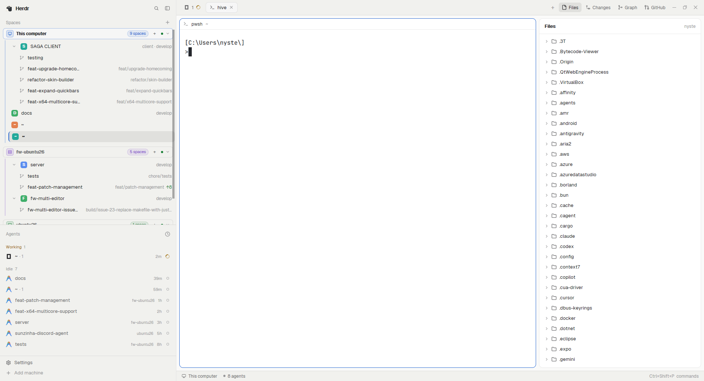

# Hive

A Herdr layout for working across several repositories and their git worktrees at
once: a chrome sidebar that groups spaces by machine, nests each repo's worktrees
under it like folders you can open and close, an agents list underneath, tab pills
with Files / Changes / Graph / GitHub buttons, terminal panes as rounded cards with
a header, and a status bar. Copy `layouts/hive.json` and the `mods/` folders into
`~/.config/herdr-app`, restart Herdr (or let it reload), and pick **Hive** in
Settings → Look or with `ctrl-shift-l`.

## What you see

Top to bottom, left to right:

- **Sidebar, 268 px** (drag the edge; it goes down to a 44 px rail and up to 480):
  - **Brand strip, 46 px** — draggable window area drawn by the shipped
    `workspace-chrome` mod, carrying the Herdr mark and search / palette buttons.
  - **Spaces** (half the remaining height, min 90 px) on `chrome`: a 31 px header
    with "Spaces" and a `+`, then one group per machine. Each group has a 30 px
    header — icon tile, machine name, a pill with its space count, `+`, a
    connected dot, a fold chevron — and the machine's spaces indented under a 2 px
    colored rule. Space rows are 30 px (28 px for worktrees): a 18 px colored
    avatar with the first letter (or a branch icon indented 22 px for a worktree),
    the name in `foreground`, and on the right, in 11.5 px `dim`, what is unusual:
    repo name, branch, `↑ahead`, `↓behind`. A repo that has worktrees shows a
    chevron before its avatar; folded, it shows a small count pill (`5`) in place
    of the rows. The active space is `selected` with a 2 px left accent border in
    the machine's color.
  - **Agents** (the other half): the shipped `agents` list — working, blocked,
    idle and done agents with their program, space and age.
  - **Footer, 69 px** — `workspace-chrome` with `{footer: true}`: settings, add
    machine, and the update/help buttons.
- **Tab bar, 42 px** on `chrome`: tab pills 29 px high (`raised` when active, 7 px
  radius) with the program icon, the tab name, a native spinner while its agent
  works, a colored dot when blocked or done, and a close `×` on the active pill;
  then `+`; then the panel buttons **Files**, **Changes**, **Graph**, **GitHub**;
  on Windows, minimize / maximize / close at the far right.
- **Panes**: a tab block with a 10 px radius card, 1 px `border` (accent while
  focused), 8 px gap, `background` fill, and a 30 px header drawn by the shipped
  `pane` mod (folder, branch, agent status, split / zoom / close). `lone: true`,
  so a tab with one pane is framed too.
- **Right panel, 368 px** (280–900, hidden until opened): a stack of **Files**
  (shipped), **Changes** (shipped), **Graph** (`git-graph`) and **GitHub**
  (`github`), each with its own header.
- **Status bar, 28 px**: `workspace-status` — this computer, machine count, agents.

## How it behaves

- **Click** a space to switch to it. **Drag** a space row up or down to reorder it
  inside its machine; while dragging the row dims and a 2 px accent line shows
  where it will land; dropping outside the machine, or on itself, cancels.
- **Right-click** a space, tab or pane opens `menu-custom`: split / zoom / close,
  rename, **Copy path**, and for a space **New worktree** / **Open worktree**
  (plus **Remove worktree** inside one), themes, and the matching keys on the
  right. Right-clicking a space asks git (in that space's folder) whether it is a
  main checkout or a linked worktree, so the worktree items only appear where
  they apply.
- **Worktrees fold like a folder**: the chevron on a repo's row hides or shows
  every worktree under it and flips right/down; folded, a small pill shows how
  many are hidden. The fold is remembered per repo in
  `localStorage["worktrees.folded"]` (keys are `[machine, .git path]` JSON), so it
  survives restarts and a moved or renamed space. The chevron swallows the mouse
  down, so pressing it never starts a drag. In the 44 px rail there is no chevron,
  and worktrees are always listed.
- **Machine groups fold** on a click on their header (remembered in
  `localStorage["machines.folded"]`); the `+` in a header makes a space on that
  machine. Worktrees are nested only when their repo's main checkout is also a
  space; otherwise they stay top-level.
- **Narrower than 160 px** the spaces and agents panels switch to a rail: a number
  and a status dot per row, no names.
- **Avatars** get one stable color from a six-color palette, shared through
  `shared("space.colors")` so every mod draws the same one; untitled `~` spaces
  are left plain.
- **Tab bar**: click a pill to select, double-click to rename, drag to reorder,
  the wheel scrolls through tabs, `×` closes the active one, `+` opens the shipped
  `new-menu` popup (terminal or any installed agent). The panel buttons toggle the
  right panel: **Files** and **Changes** (from `shared("workspace.panels")`),
  **Graph**, **GitHub**. Which panel a space has open is remembered per space in
  `localStorage["panels"]`; switching spaces restores that space's choice.
- **Agent state**: working shows the native spinner (`.spin(900)`, no timer),
  blocked and done show a dot in their theme color, idle shows nothing; the space
  and machine colors come from `theme()`, so the layout follows light/dark.
- **Graph** lists the repo's commits in lanes with refs, fetch/push/pull and the
  usual actions (checkout, branch, tag, stash, cherry-pick, revert, reset) behind
  confirm dialogs; it watches the repo folder and refreshes itself.
- **GitHub** lists PRs and issues for the repo with kind tabs, search, sort,
  label filters and CI badges, and its **Agent** button starts a coding agent on an
  issue.
- **Keys** the layout expects (all optional): the `Ctrl+1…9` tab keys,
  `ctrl-shift-l` to switch layouts, and — if you bind them — `mod.open:picker`
  and `mod.open:github` for the mods' own overlays. `tabs-graph` also listens for
  keys of the form `<mod>.<command>` to open a panel.

## Built from

- `layouts/hive.json` — root is a `row`, `"titlebar": "none"`, `traffic_lights
  [12, 16]`, `background: canvas`, `terminal_padding [14, 12]`, `divider` 1 px
  `border`, and `"terminal_menu": "menu-custom"`. Children:
  - `sidebar` (`column`, `px 268`, min 44, max 480, `background: chrome`,
    `resizable: false`): `brand` (`block`, 46 px, `workspace-chrome`,
    `window_drag`), `sidebar-lists` (`column`) with `spaces`
    (`spaces-highlight`, weight 1, min 90) and `agents` (weight 1, min 90), and
    `sidebar-footer` (69 px, `workspace-chrome` props `{footer: true}`).
  - `work` (`column`, `resizable: false`): `tabs` (42 px, `tabs-graph`,
    `window_drag`), `work-body` (`row`, padding 8, gap 8) with `main`
    (`{ "tab": "active" }`, pane card: 10 px radius, 1 px `border`, `focus`
    accent, `gap 8`, `lone: true`, 30 px header on top, `always`, mod `pane`) and
    `panel` (`column`, 368 px, 280–900, `hidden: true`) whose `panel-body`
    (`stack`) holds `files`, `changes`, `graph` (`git-graph`) and `github`;
    `status` (28 px, `workspace-status`).
- `mods/spaces-highlight` — a clone of Herdr's `spaces` (0.1.10) with machine
  headers, colors and the worktree fold. Reads `spaces()`, `panes()`,
  `machines()`, `layout()`, `theme()`, `shared` / `setShared`; runs
  `exec("git", ["--no-optional-locks", "-c", "core.fsmonitor=false", "status",
  "--porcelain=v2", "--branch"])`, `git rev-parse --show-toplevel` and
  `--git-common-dir` per space (on that space's machine), `hc machine ls --json`,
  and `watchFolder(repo)` for local repos. Commands: `space.select`, `space.move`,
  `space.new`, `space.rename`, `space.close` through `menu-custom`.
- `mods/tabs-graph` — a clone of `tabs` (0.1.10) with pills, the panel buttons and
  the panel actions. Reads `spaces()`, `panes()`, `layout()`, `window()`,
  `settings()`, `shared()`; runs `tab.select`, `tab.move`, `tab.rename`,
  `tab.close`, `tab.next|prev`, `layout.show|hide|select`,
  `window.minimize|maximize|close`, and `openOverlay(new-menu)`.
- `mods/git-graph` — graph panel plus its right-click menu and dialogs
  (`graph.js`, `git.js`, `lanes.js`, `act.js`, `menu.js`, `dialog.js`); runs `git`
  in the space's folder and watches it. Icons include Lucide files under
  `icons/` (see `LICENSE-lucide.txt`).
- `mods/github` — PR/issue panel and the status-bar CI badge (`panel.js`,
  `ci.js`, `checks.js`, `open.js`, `urls.js`); runs the `gh` CLI (`gh pr list`,
  `gh issue list`, `gh pr view --json statusCheckRollup`, …) and opens URLs in the
  system browser. Needs `gh` installed and authenticated.
- `mods/menu-custom` — a clone of the shipped `menu` (0.1.11) turned into a whole
  context-menu replacement: pane / tab / space / global items, **Copy path**
  (`cx.write_to_clipboard` plus a toast), the `worktree` dialog, theme picks and
  key hints. The layout wires it with the root `terminal_menu`.
- Shipped mods it relies on: `workspace-chrome` (brand and footer), `agents`,
  `pane`, `files`, `changes`, `workspace-status`, `new-menu`.

## Watch out

- `spaces-highlight` and `tabs-graph` are **clones** of Herdr 0.1.10 mods, and
  `menu-custom` of 0.1.11. A Herdr update that changes those shipped mods will not
  change the clones; re-clone and re-apply the local changes if you want the
  fixes. `AGENTS.md` in the app home describes `herdr-app check` and cloning.
- Worktrees only nest when git answers for both the main checkout and the linked
  one; a space whose machine is offline, or a folder that is not a git repository,
  is shown flat. On first load the list is flat for a second or two until the
  `git status` calls return (longer for remote machines).
- `git status` walks the whole tree: it runs when a place is new, when an agent's
  turn ends, when a machine comes back, and every 60 s for repos in view while the
  window is in front. `watchFolder` only works on this computer, so remote repos
  rely on the fallback.
- The worktree fold has no key of its own, and the 44 px rail can't fold (it lists
  everything so nothing becomes unreachable).
- The panel stack needs all four mods installed; a missing mod shows an empty
  block. The Graph and GitHub panels need `git` and `gh` in the user's shell; the
  GitHub panel is empty without an authenticated `gh`. Its **Agent** button opens
  the `issue-agent` mod, which is neither shipped by Herdr nor included here, so
  the button does nothing unless the reader installs that mod.
- `menu-custom` **replaces** Herdr's terminal and space menus entirely (it is the
  layout's `terminal_menu`), so its item list is the whole menu.
- The layout sets no theme, fonts or colors: it follows `settings.json` and the
  theme picker, so the screenshots show graphite with the default fonts. The
  sidebar sizes and the theme come from `layouts/.state/hive.json` once the window
  is resized or the theme is picked.
- Windows window buttons are drawn by `tabs-graph` from its own `win-*.svg`; on
  macOS the system buttons sit over the layout at `traffic_lights` and the tab bar
  reserves room for them.

## Done when

- `herdr-app check mods/spaces-highlight`, `mods/tabs-graph`, `mods/git-graph`,
  `mods/github` and `mods/menu-custom` each print `check passed`.
- `herdr-app do layout.switch --name hive` (or `ctrl-shift-l`) shows the sidebar
  with machine groups, the agents list under it, tab pills with Files / Changes /
  Graph / GitHub, and a terminal card with a header.
- On a repo with worktrees, clicking the chevron before the repo's avatar hides its
  worktree rows, turns the chevron right and shows a count pill; clicking again
  brings them back, and a restart keeps the fold.
- Dragging a space inside its machine reorders it; the accent line shows the drop.
- Right-clicking a space offers Copy path, New worktree, Open worktree, and
  Remove worktree when the space is a worktree.
- The Files, Changes, Graph and GitHub buttons open and close the right panel, and
  switching spaces restores each space's panel.
